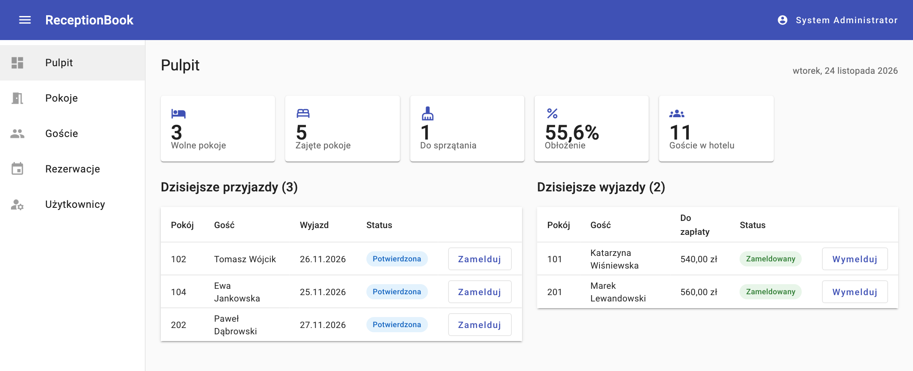
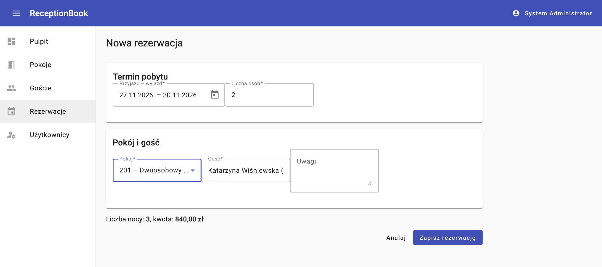
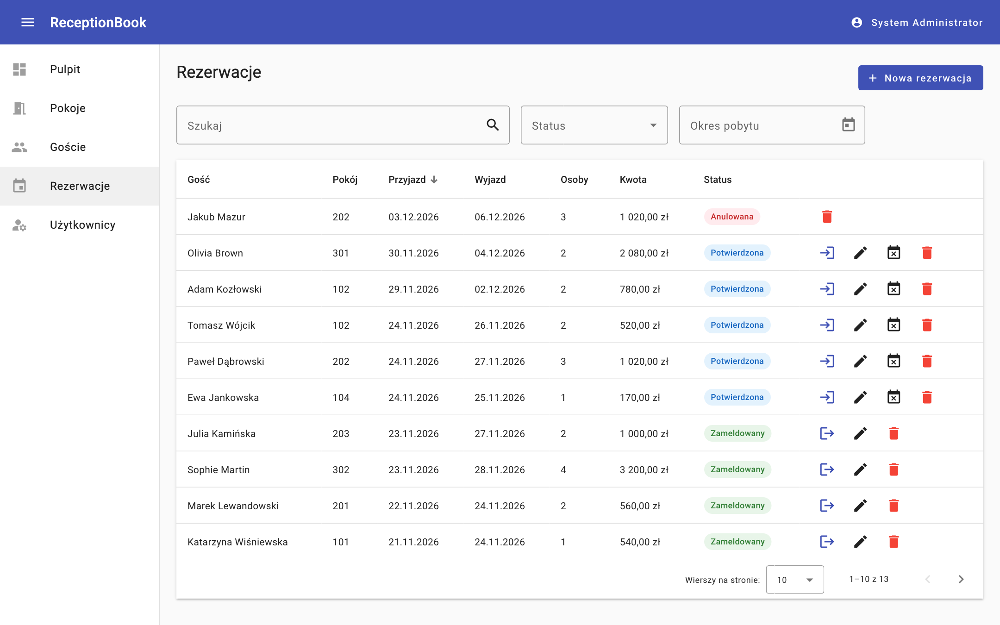
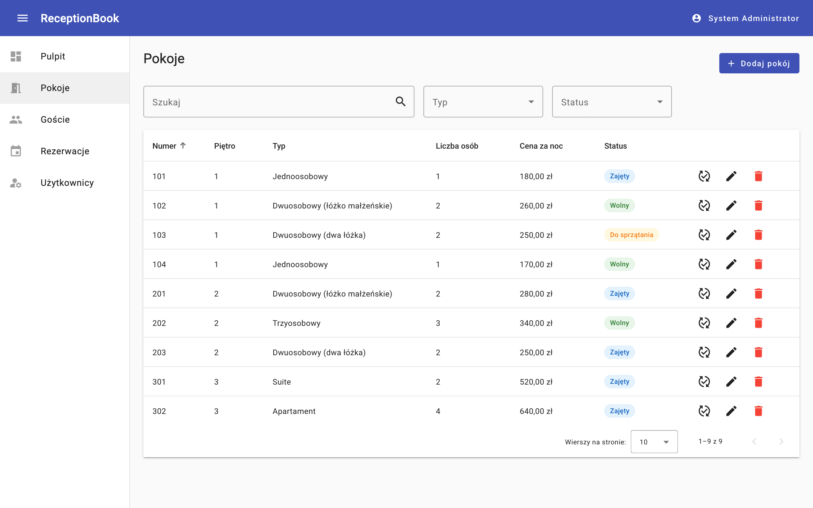
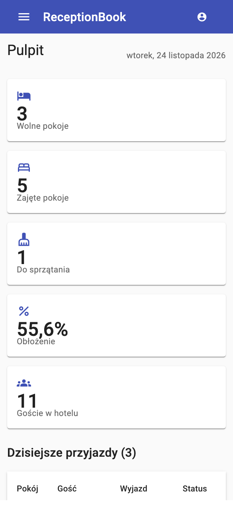

# ReceptionBook

**ReceptionBook** is a web application for hotel reception staff. It keeps track of rooms, guests and stays, shows what
has to be done today and makes sure that no room is booked twice.

The project was created as part of the engineering thesis
*„Architektura i bezpieczeństwo nowoczesnych aplikacji internetowych na przykładzie aplikacji ReceptionBook”*.



## What the application does

The user interface is in Polish. The screenshots show demo data with fictional guests.

### Start of the day

The dashboard (above) shows how many rooms are free, occupied or waiting for cleaning, the occupancy rate and the number
of guests in the hotel. Below are today's arrivals and departures, with check-in and check-out one click away.

### Booking a stay

The receptionist picks the dates and the number of guests, and the form offers only rooms that are free in that period
and big enough. The guest is found by name or document number, and the price is calculated from the room rate and the
number of nights. The API checks availability again when the reservation is saved.



### Reservations

All reservations can be searched by guest or room and filtered by status and period. The available actions depend on the
status of the reservation:

| Action | Reservation status | Room status |
| --- | --- | --- |
| New reservation | Confirmed | unchanged |
| Check-in | Confirmed → Checked in | Available → Occupied |
| Check-out | Checked in → Checked out | Occupied → Cleaning |
| Cancellation | Confirmed → Cancelled | unchanged |

Check-in is possible only during the booked stay and only when the room is ready.



### Rooms and guests

Each room has a type, floor, capacity, price and status, e.g. it goes back from cleaning to available when it is ready.
The guest list keeps contact details and document numbers for future stays. Rooms and guests that have reservations
cannot be deleted.



### Roles

| | Receptionist | Administrator |
| --- | :---: | :---: |
| Dashboard, reservations, check-in and check-out | ✓ | ✓ |
| Adding and editing guests, changing the status of a room | ✓ | ✓ |
| Adding, editing and deleting rooms | | ✓ |
| Deleting guests and reservations | | ✓ |
| Employee accounts | | ✓ |

The layout also works on a phone:



## Repository structure

| Directory | Description | Tech stack |
| --- | --- | --- |
| [`backend`](backend) | REST API | .NET 8, ASP.NET Core, Entity Framework Core, SQL Server |
| [`frontend`](frontend) | Web client | Angular 16, Angular Material, nginx |

Each directory has its own README with features, security notes and detailed setup instructions.

## Development

Configure the database and secrets as described in the [backend README](backend/README.md#getting-started), then run
both applications in separate terminals:

```bash
cd backend/ReceptionBook
dotnet run --launch-profile https
```

```bash
cd frontend
npm ci
npm start
```

The application is available at <http://localhost:4200> and the API at <https://localhost:7285/swagger>.

## Docker

Start the database and the API:

```bash
cd backend
cp .env.example .env   # fill in DB_PASSWORD, JWT_SECRET_KEY and ADMIN_PASSWORD
docker compose up --build
```

Then start the client in another terminal:

```bash
cd frontend
docker build -t receptionbook-web .
docker run -p 4200:80 -e API_URL=http://host.docker.internal:8080 receptionbook-web
```

## Tests

```bash
(cd backend && dotnet test)
(cd frontend && npm ci && npm run test:ci)
```
